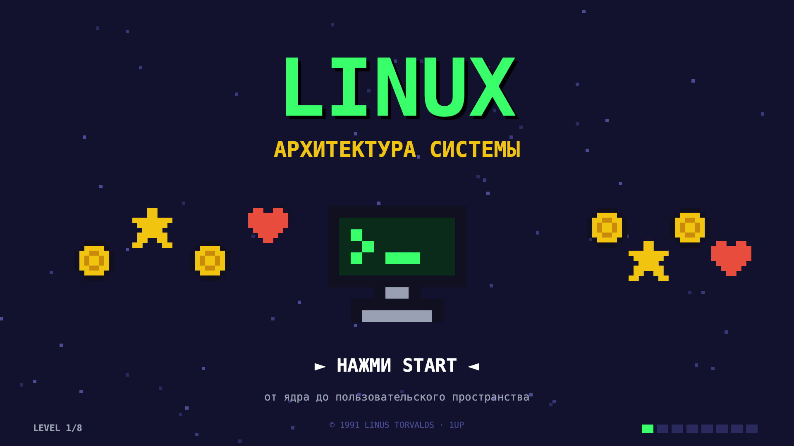
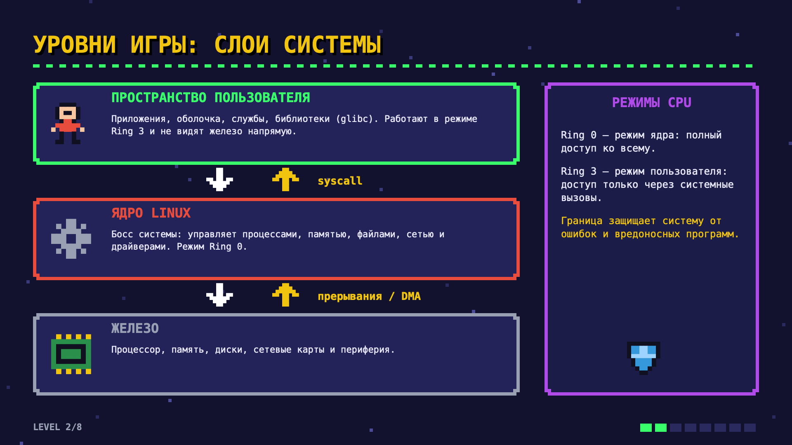
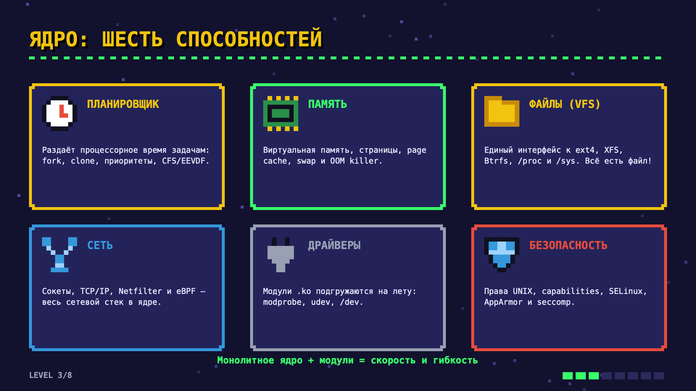
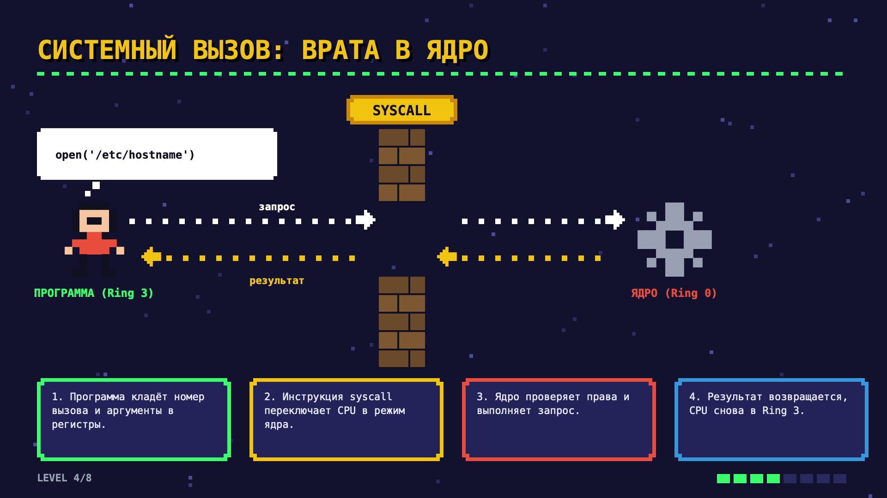
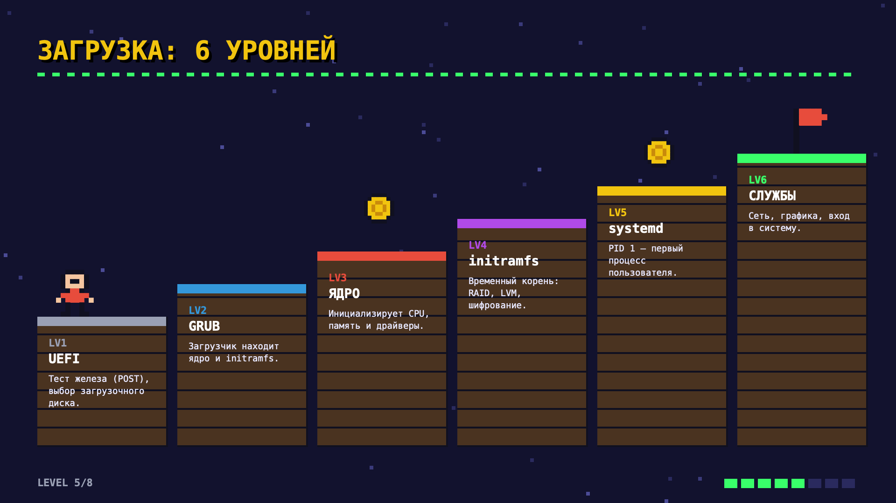
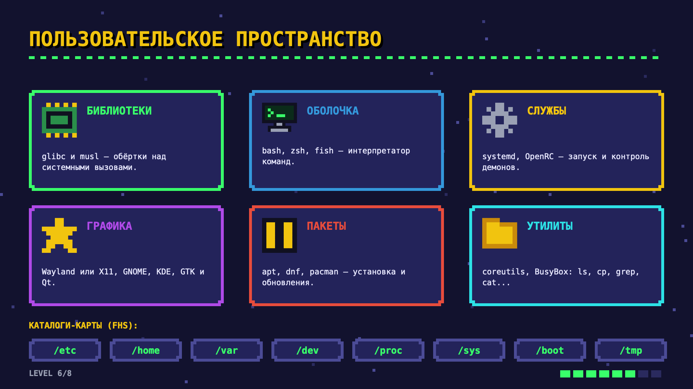
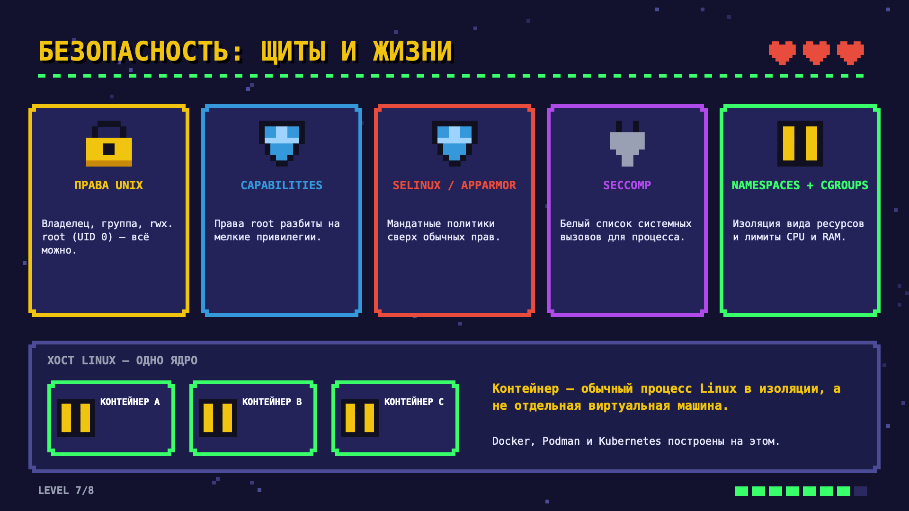
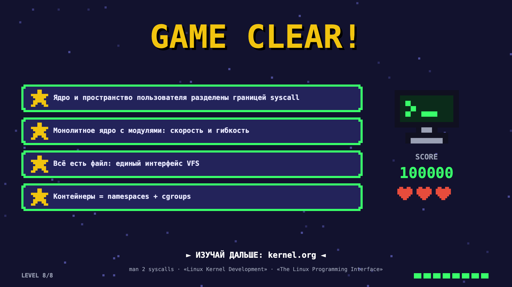

Презентация для новичков: как устроен Linux от железа до пользовательского пространства.
Восемь слайдов-уровней в стиле 8-битной игры. Под каждым слайдом есть его текстовая версия.

[Скачать презентацию в PDF](./assets/linux-architecture/linux-architecture-8bit.pdf)

## Уровень 1. Linux: архитектура системы

От ядра до пользовательского пространства. Нажми **Start**.

## Уровень 2. Слои системы

| Слой | Что в нём | Режим CPU |
| --- | --- | --- |
| Пространство пользователя | приложения, оболочка, службы, библиотеки (glibc); железо напрямую не видят | Ring 3 |
| Ядро Linux | «босс» системы: процессы, память, файлы, сеть и драйверы | Ring 0 |
| Железо | процессор, память, диски, сетевые карты и периферия | — |

- Пространство пользователя обращается к ядру через **системные вызовы** (syscall).
- Железо сообщает ядру о событиях через **прерывания** и обменивается данными через **DMA**.
- **Ring 0** — режим ядра, полный доступ ко всему. **Ring 3** — режим пользователя, доступ только
  через системные вызовы. Граница между ними защищает систему от ошибок и вредоносных программ.

## Уровень 3. Ядро: шесть способностей

| Способность | Что делает |
| --- | --- |
| Планировщик | раздаёт процессорное время задачам: fork, clone, приоритеты, CFS/EEVDF |
| Память | виртуальная память, страницы, page cache, swap и OOM killer |
| Файлы (VFS) | единый интерфейс к ext4, XFS, Btrfs, `/proc` и `/sys`. Всё есть файл! |
| Сеть | сокеты, TCP/IP, Netfilter и eBPF — весь сетевой стек в ядре |
| Драйверы | модули `.ko` подгружаются на лету: `modprobe`, udev, `/dev` |
| Безопасность | права UNIX, capabilities, SELinux, AppArmor и seccomp |

Монолитное ядро + модули = скорость и гибкость.

## Уровень 4. Системный вызов: врата в ядро

Что происходит при вызове `open('/etc/hostname')`:

1. Программа (Ring 3) кладёт номер вызова и аргументы в регистры.
2. Инструкция `syscall` переключает CPU в режим ядра.
3. Ядро (Ring 0) проверяет права и выполняет запрос.
4. Результат возвращается, CPU снова в Ring 3.

## Уровень 5. Загрузка: 6 уровней

1. **UEFI** — тест железа (POST), выбор загрузочного диска.
2. **GRUB** — загрузчик находит ядро и initramfs.
3. **Ядро** — инициализирует CPU, память и драйверы.
4. **initramfs** — временный корень: RAID, LVM, шифрование.
5. **systemd** — PID 1, первый процесс пользовательского пространства.
6. **Службы** — сеть, графика, вход в систему.

## Уровень 6. Пользовательское пространство

| Компонент | Примеры |
| --- | --- |
| Библиотеки | glibc и musl — обёртки над системными вызовами |
| Оболочка | bash, zsh, fish — интерпретатор команд |
| Службы | systemd, OpenRC — запуск и контроль демонов |
| Графика | Wayland или X11, GNOME, KDE, GTK и Qt |
| Пакеты | apt, dnf, pacman — установка и обновления |
| Утилиты | coreutils, BusyBox: `ls`, `cp`, `grep`, `cat`… |

Каталоги-карты (FHS): `/etc`, `/home`, `/var`, `/dev`, `/proc`, `/sys`, `/boot`, `/tmp`.
Подробнее о них — в конспекте [«Linux: как не потеряться в файловой системе»](./linux-navigation.md).

## Уровень 7. Безопасность: щиты и жизни

| Щит | Что даёт |
| --- | --- |
| Права UNIX | владелец, группа, rwx; root (UID 0) может всё |
| Capabilities | права root разбиты на мелкие привилегии |
| SELinux / AppArmor | мандатные политики сверх обычных прав |
| seccomp | белый список системных вызовов для процесса |
| Namespaces + cgroups | изоляция видимых ресурсов и лимиты CPU и RAM |

Хост Linux — одно ядро, на нём контейнеры A, B и C. **Контейнер — обычный процесс Linux в изоляции,
а не отдельная виртуальная машина.** Docker, Podman и Kubernetes построены на этом.

## Уровень 8. Game clear

Итоги:

- ядро и пространство пользователя разделены границей syscall;
- монолитное ядро с модулями — это скорость и гибкость;
- всё есть файл: единый интерфейс VFS;
- контейнеры = namespaces + cgroups.

Изучай дальше: [kernel.org](https://www.kernel.org), `man 2 syscalls`, книги
«Linux Kernel Development» (Robert Love) и «The Linux Programming Interface» (Michael Kerrisk).
