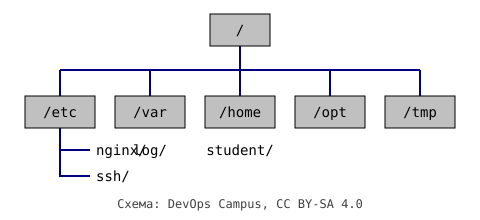

Конспект первого занятия по Linux: куда смотреть, когда сервер незнакомый, и какие
команды помогают быстро сориентироваться.

## Где что лежит

В Linux всё растёт из одного корня `/`. Каталоги верхнего уровня договорились
использовать одинаково почти во всех дистрибутивах:



| Каталог | Что там | Когда заглядывать |
| --- | --- | --- |
| `/etc` | конфигурация системы и сервисов | поменять настройки nginx, ssh, cron |
| `/var/log` | журналы | что-то сломалось и нужно понять что |
| `/home` | домашние каталоги пользователей | свои скрипты и заметки |
| `/opt` | стороннее ПО «целиком» | приложения, поставленные не из пакетов |
| `/tmp` | временные файлы | очищается при перезагрузке |

## Пять команд для первой минуты на сервере

```bash
pwd                 # где я?
ls -lah             # что здесь, включая скрытые файлы и права
cd -                # вернуться в предыдущий каталог
tree -L 2 /etc      # структура на два уровня вглубь (если установлен tree)
df -h && du -sh *   # сколько места занято на дисках и в текущем каталоге
```

## Пути: абсолютные и относительные

- **Абсолютный** путь начинается с `/` и работает откуда угодно: `/var/log/syslog`.
- **Относительный** считается от текущего каталога: `../log/syslog`.
- `~` означает домашний каталог текущего пользователя, `.` текущий каталог, `..` родительский.

> Совет: в скриптах используйте абсолютные пути. Скрипт, запущенный из cron,
> стартует совсем не из того каталога, где вы его тестировали.

## Мини-практика

1. Найдите, сколько места занимают журналы: `sudo du -sh /var/log`.
2. Посмотрите последние 20 строк системного журнала: `sudo tail -n 20 /var/log/syslog`
   (на некоторых дистрибутивах вместо файла используется `journalctl -n 20`).
3. Найдите все конфиги с расширением `.conf` в `/etc` не глубже двух уровней:
   `find /etc -maxdepth 2 -name "*.conf"`.

Следующая тема: права доступа и пользователи. Общие материалы по теме лежат в
[папке Linux](../../topics/linux/README.md).
