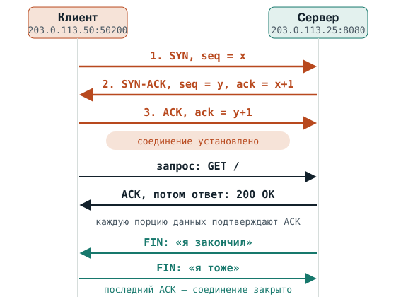

Теория перед вторым занятием практикума по сетям: адреса и порты, TCP и UDP, ping, DNS, файрвол и команды, которыми всё это видно.

На занятии будем разбираться, почему сервер «не открывается». Ведущий вводит команды, а вы подсказываете, что проверить. Здесь теория, которая для этого нужна.

Читать около 25 минут. Вывод в чёрных блоках настоящий, снят на учебном стенде. Повторять команды не обязательно: на занятии их вводит ведущий.

## 1. Путь запроса

Вы открываете сайт, или приложение на сервере обращается к API. Кажется, что это одно действие. На самом деле запрос проходит цепочку шагов, и на каждом что-то может пойти не так.

| Шаг | Что происходит | Чем проверить |
| --- | --- | --- |
| 1. Имя | `github.com` | `dig`, `getent` |
| 2. Адрес | `140.82.121.4` | `curl -v` |
| 3. Сеть | пакеты идут до сервера | `ping` |
| 4. Файрвол | пустить или нет | `iptables` |
| 5. Программа | ждёт на порту | `ss`, `curl` |

Сначала имя, например `github.com`, превращается в адрес: этим занимается DNS. Потом пакеты с запросом идут по сети до сервера. На сервере их встречает файрвол и решает, пропустить или нет. Пропущенные пакеты система передаёт программе, которая ждёт на нужном порту. Программа отвечает, и ответ идёт тем же путём обратно.

Когда что-то «не открывается», сломано одно из звеньев. Диагностика — это проверка звеньев по очереди: работает ли имя, жив ли сервер, ждёт ли кто-нибудь на порту, доходят ли пакеты. В таблице написано, чем смотреть каждое звено. Дальше разберём каждое звено и эти команды.

## 2. Адрес и порт

**IP-адрес** — адрес машины в сети, как адрес дома. Записывается четырьмя числами от 0 до 255 через точку: `203.0.113.25`. У каждого сервера и у каждого ноутбука в сети свой адрес.

Посмотреть адреса своей машины можно командой `ip -br addr`, ключ `-br` значит «коротко». Здесь `eth0` — сетевая карта сервера, `UP` — она включена, а `/24` после адреса говорит о размере сети, это тема занятия про адреса и маршруты.

На сервере:

```text
admin@srv:~$ ip -br addr show eth0
eth0@if25        UP             203.0.113.25/24
```

| В выводе | Что значит |
| --- | --- |
| `eth0` | Имя сетевой карты. На серверах бывает `eth0`, `ens3`, `enp0s3`. Хвост `@if25` здесь потому, что учебный сервер — контейнер: у обычного сервера его нет. |
| `203.0.113.25/24` | Адрес сервера и размер его сети. |

**Порт** — номер программы на машине, как номер квартиры в доме. На одном сервере работает много программ, и каждая ждёт подключений на своём порту. Порт — число от 1 до 65535. Пара «адрес:порт», например `203.0.113.25:8080`, указывает на конкретную программу на конкретном сервере.

| Порт | Кто обычно на нём |
| --- | --- |
| 22 | SSH, удалённый вход на сервер |
| 53 | DNS |
| 80 | HTTP, сайты без шифрования |
| 443 | HTTPS, сайты с шифрованием |
| 5432 | PostgreSQL |
| 8080 | часто приложения и веб-серверы для разработки |

Больше портов — в [шпаргалке по сетевым портам](../../topics/networks/ports-cheatsheet.md).

Порт есть с обеих сторон. Сервер ждёт на известном порту, а клиент для каждого подключения берёт себе случайный свободный порт. Поэтому одно соединение описывают четыре числа: адрес и порт клиента, адрес и порт сервера. Например, `203.0.113.50:50200 → 203.0.113.25:8080`.

Про программу, которая ждёт подключений, говорят: она **слушает порт**. Слушать можно не на всех адресах сразу, и тут важны два особых адреса.

| Адрес | Что значит |
| --- | --- |
| `127.0.0.1` (localhost) | Адрес, через который машина обращается сама к себе. Пакеты на него никогда не выходят наружу, в сеть. Его ещё называют loopback, а сетевую «карту» для него — `lo`. |
| `0.0.0.0` | Когда программа слушает этот адрес, это значит «на всех адресах этой машины». |
| `203.0.113.25` | Конкретный адрес. Программа, которая слушает его, примет подключения только через этот адрес. |
| `::` и `::1` | То же самое для IPv6: «все адреса» и localhost. |

## 3. TCP и UDP: как программы обмениваются данными

Данные по сети идут **пакетами** — небольшими порциями. Пакет похож на конверт: на нём написано, откуда он (адрес и порт отправителя) и куда (адрес и порт получателя), а внутри лежат данные.

Как именно программы обмениваются пакетами, решает протокол. Основных два: TCP и UDP.

**TCP** похож на телефонный звонок. Сначала стороны соединяются, потом разговаривают, в конце прощаются. TCP следит, чтобы всё дошло и в правильном порядке: каждая порция данных пронумерована, получатель подтверждает, что получил, а потерянное отправляется ещё раз. На TCP работают сайты, SSH, базы данных.

Соединение TCP начинается с **трёхстороннего рукопожатия** (three-way handshake):

1. **SYN** — клиент: «хочу подключиться». И называет свой начальный номер `seq`, с которого будет считать свои байты.
2. **SYN-ACK** — сервер: «согласен». Называет свой начальный номер и подтверждает номер клиента: `ack` = номер клиента + 1.
3. **ACK** — клиент подтверждает номер сервера. Соединение установлено, можно отправлять данные.



На схеме одно HTTP-соединение по TCP. Первые три стрелки — рукопожатие, последние — закрытие. Здесь первым закрывает сервер, бывает и наоборот.

Закрывается соединение тоже по шагам: одна сторона отправляет **FIN** («я закончил»), другая подтверждает и отправляет свой FIN, первая подтверждает.

Есть ещё **RST** — резкий отказ или обрыв. Например, если пакет SYN пришёл на порт, где никто не слушает, система сервера сразу отвечает RST. Клиент получает ошибку **Connection refused**, «в подключении отказано», и получает её мгновенно.

А если пакет по дороге кто-то молча выбросил, ответа не будет вообще. Клиент повторяет SYN ещё несколько раз и в конце концов сдаётся с ошибкой **Connection timed out**, «время ожидания вышло». Это долго: без ограничений клиент на Linux ждёт около двух минут.

**UDP** похож на открытку: отправил и всё. Без соединения, без подтверждений и без повторной отправки. Зато быстро и просто: один пакет — вопрос, один пакет — ответ. На UDP работают DNS, голосовые и видеозвонки, игры, синхронизация времени. Там лучше быстро получить почти всё, чем долго ждать повтора потерянного.

| | TCP | UDP |
| --- | --- | --- |
| Соединение | сначала рукопожатие | нет, сразу отправляем |
| Доставка | гарантирует: потерянное отправит ещё раз | не гарантирует |
| Порядок | сохраняет | не следит |
| Скорость | медленнее, больше служебных пакетов | быстрее |
| Где используется | HTTP и HTTPS, SSH, базы данных | DNS, звонки и видео, игры, NTP |

У каждого TCP-соединения есть **состояние**. Его показывает команда `ss`, о ней ниже. Самые важные состояния:

| Состояние | Что значит |
| --- | --- |
| `LISTEN` | программа слушает порт и ждёт подключений |
| `SYN-SENT` | клиент отправил SYN и ждёт ответа |
| `ESTAB` (ESTABLISHED) | соединение установлено, идёт обмен данными |
| `FIN-WAIT-2` | мы закрыли соединение и ждём, когда закроет другая сторона |
| `TIME-WAIT` | соединение закрыто. Сторона, которая закрыла первой, ещё около минуты помнит его, чтобы опоздавшие пакеты не попали в новое соединение. Немного TIME-WAIT — это нормально. |
| `CLOSE-WAIT` | другая сторона закрыла соединение, а наша программа своё ещё нет. Если таких сотни — программа забывает закрывать соединения, это ошибка в её коде. |

## 4. ping и ICMP

**ping** проверяет, жива ли машина и доходят ли до неё пакеты. Он отправляет сигнал «ты здесь?» и ждёт ответ «я здесь».

Работает ping не по TCP и не по UDP, а по третьему протоколу — **ICMP**. Это служебный протокол самой сети: им передаются проверки связи и сообщения об ошибках. **Портов у ICMP нет**, вместо них тип сообщения: echo request (запрос) и echo reply (ответ). Поэтому на вопрос «на каком порту работает ping» правильный ответ — ни на каком.

На ноутбуке:

```text
admin@laptop:~$ ping -c 3 203.0.113.25
PING 203.0.113.25 (203.0.113.25) 56(84) bytes of data.
64 bytes from 203.0.113.25: icmp_seq=1 ttl=64 time=0.136 ms
64 bytes from 203.0.113.25: icmp_seq=2 ttl=64 time=0.159 ms
64 bytes from 203.0.113.25: icmp_seq=3 ttl=64 time=0.176 ms

--- 203.0.113.25 ping statistics ---
3 packets transmitted, 3 received, 0% packet loss, time 2061ms
rtt min/avg/max/mdev = 0.136/0.157/0.176/0.016 ms
```

| В выводе | Что значит |
| --- | --- |
| `-c 3` | Отправить три запроса и остановиться. Без этого ключа ping работает, пока не нажать Ctrl+C. |
| `icmp_seq=1` | Номер запроса. Пропуски в номерах значат, что часть ответов потерялась. |
| `ttl=64` | Сколько ещё маршрутизаторов пакет может пройти. Linux отправляет с числом 64, каждый маршрутизатор по дороге уменьшает его на один. |
| `time=0.136 ms` | Время туда и обратно. Здесь доли миллисекунды: машины стоят рядом. |
| `0% packet loss` | Потерь нет, все ответы пришли. |

> ping проходит — значит, машина включена и сеть до неё есть. Но о программах на ней это ничего не говорит: сайт при этом может не открываться. И наоборот, ping часто запрещают на файрволе, а сайт работает.

## 5. DNS: как имя превращается в адрес

Людям удобны имена, а сети нужны адреса. **DNS** — это телефонная книга интернета: по имени выдаёт адрес.

Имена в DNS устроены деревом. На вершине — **корень**, его записывают точкой. Ниже — зоны верхнего уровня: `com`, `ru`, `org`. Ниже — домены: `github.com`, `ya.ru`. Полное имя читается справа налево: `api.github.com.` — это корень, потом `com`, потом `github`, потом `api`. Серверы каждого уровня знают, кто отвечает за уровень ниже.

Вот что происходит на сервере Linux, когда программа обращается по имени:

1. **Программа** (curl, приложение) просит у системы адрес для имени `github.com`.
2. **`/etc/nsswitch.conf`**, строка `hosts: files dns`: сначала смотреть файлы, потом DNS.
3. **`/etc/hosts`** — записи, сделанные руками. Если имя есть здесь, дальше система не идёт.
4. **`/etc/resolv.conf`** говорит, кого спрашивать: `127.0.0.53`.
5. **Местный резолвер** systemd-resolved на `127.0.0.53`. Есть ответ в кэше — отдаёт сразу.
6. **DNS-сервер** провайдера или публичный, например `1.1.1.1`. Тоже со своим кэшем.
7. **Если ответа нет в кэше**: корневой сервер → серверы зоны `com` → серверы домена `github.com`, которые и знают адрес.

Посмотрим на эти файлы на учебном сервере. В `/etc/hosts` обычные служебные записи: `localhost` и имя самого сервера. В `/etc/nsswitch.conf` порядок: сначала файлы, потом DNS. В `/etc/resolv.conf` — адрес местного резолвера.

На сервере:

```text
admin@srv:~$ cat /etc/hosts
127.0.0.1       localhost
::1     localhost ip6-localhost ip6-loopback
fe00::  ip6-localnet
ff00::  ip6-mcastprefix
ff02::1 ip6-allnodes
ff02::2 ip6-allrouters
203.0.113.25    srv
admin@srv:~$ grep hosts /etc/nsswitch.conf
hosts:          files dns
admin@srv:~$ cat /etc/resolv.conf
nameserver 127.0.0.53
options edns0 trust-ad
search .
```

| В выводе | Что значит |
| --- | --- |
| `127.0.0.1 localhost` | Имя localhost всегда ведёт на саму машину. |
| `hosts: files dns` | Сначала `/etc/hosts`, потом DNS. Запись в `/etc/hosts` главнее DNS. |
| `nameserver 127.0.0.53` | DNS-запросы уходят местному резолверу systemd-resolved. Так устроено на Ubuntu по умолчанию. |

**Кэш и TTL.** Чтобы не ходить каждый раз до корня, ответы хранятся в кэше: у местного резолвера, у DNS-сервера провайдера, у браузера. У каждой записи есть **TTL** (time to live) — сколько секунд её можно хранить. Отсюда частая ситуация: адрес сервера поменяли, а часть пользователей ещё какое-то время ходит на старый. У них в кэше старый ответ, и он живёт, пока не истечёт TTL.

**Транспорт.** DNS работает на **порту 53**, обычно по **UDP**: один пакет — вопрос, один — ответ. По **TCP** на тот же порт 53 — если ответ большой и не влезает в один UDP-пакет, и когда DNS-серверы передают друг другу зону целиком. Бывает ещё DNS поверх шифрования: DNS over TLS на порту 853 и DNS over HTTPS на 443.

**Записи.** В DNS хранится не только адрес. Основные типы записей:

| Запись | Что хранит | Пример |
| --- | --- | --- |
| `A` | адрес IPv4 | `github.com` → `140.82.121.4` |
| `AAAA` | адрес IPv6 | `ya.ru` → `2a02:6b8::2:242` |
| `CNAME` | псевдоним: «смотри другое имя» | `www.github.com` → `github.com` |
| `MX` | почтовый сервер домена | `github.com` → `...mail.protection.outlook.com` |
| `NS` | DNS-серверы, которые отвечают за домен | `ya.ru` → `ns1.yandex.ru` |
| `TXT` | текст: SPF для почты, подтверждение владения доменом | `v=spf1 redirect=_spf.yandex.ru` |
| `PTR` | обратная запись: по адресу имя | `8.8.8.8` → `dns.google` |
| `SOA` | главная запись зоны: основной сервер, серийный номер, таймеры | |
| `SRV` | где найти сервис: хост и порт | используется, например, в Kubernetes |

## 6. Файрвол

**Файрвол** — охранник на входе со списком правил. Каждое правило — это условие и действие: «пакеты по TCP на порт 5432 — выбросить». Пакет проверяется по правилам сверху вниз, первое подходящее правило решает его судьбу. Если не подошло ни одно, действует правило по умолчанию.

Файрволы бывают в двух местах. **На самом сервере**: в Linux он встроен в ядро, правила смотрят командами `iptables` или `nft`, а на Ubuntu бывает ещё надстройка `ufw`. И **снаружи сервера**: в облаке это группы безопасности (security groups) и облачные файрволы, их видно только в консоли облака, с сервера их не посмотреть.

Действия, которые важно различать:

| Действие | Что делает | Что видит клиент |
| --- | --- | --- |
| `ACCEPT` | пропустить | всё работает |
| `DROP` | выбросить молча | ответа нет, клиент повторяет SYN и ждёт до тайм-аута |
| `REJECT` | выбросить и сообщить отправителю | сразу получает отказ |

Правила для входящих пакетов лежат в цепочке `INPUT`. Ключ `-S` печатает их так, как они были добавлены. На учебном сервере в рабочем состоянии правил нет, только правило по умолчанию.

На сервере:

```text
admin@srv:~$ sudo iptables -S INPUT
-P INPUT ACCEPT
```

| В выводе | Что значит |
| --- | --- |
| `-P INPUT ACCEPT` | Правило по умолчанию (policy) для входящих: пропускать. Других правил нет. |

Если бы правило было, оно выглядело бы так: `-A INPUT -p tcp -m tcp --dport 5432 -j DROP`. Читаем по частям: `-A INPUT` — добавлено в цепочку входящих, `-p tcp` — протокол TCP, `--dport 5432` — порт назначения 5432, `-j DROP` — действие: выбросить.

## 7. Инструменты

Команды, которыми проверяют звенья цепочки. У каждой — на какой вопрос она отвечает, настоящий вывод с учебного стенда и как его читать. Сервер стенда — `203.0.113.25`, на нём приложение на порту 8080. Ноутбук — `203.0.113.50`.

### curl

**Отвечает ли программа по адресу и порту, и что она отвечает.**

curl отправляет запрос на веб-адрес и печатает ответ. Ключ `-v` (verbose) показывает весь разговор: строки со звёздочкой — что делает сам curl, со знаком `>` — что он отправил, со знаком `<` — что пришло в ответ.

На ноутбуке:

```text
admin@laptop:~$ curl http://203.0.113.25:8080
{"service": "report-api", "status": "ok"}
```

```text
admin@laptop:~$ curl -v http://203.0.113.25:8080
*   Trying 203.0.113.25:8080...
* Connected to 203.0.113.25 (203.0.113.25) port 8080
> GET / HTTP/1.1
> Host: 203.0.113.25:8080
> User-Agent: curl/8.5.0
> Accept: */*
>
* HTTP 1.0, assume close after body
< HTTP/1.0 200 OK
< Server: BaseHTTP/0.6 Python/3.12.3
< Date: Wed, 21 Oct 2026 08:51:54 GMT
< Content-Type: application/json
< Content-Length: 42
<
{"service": "report-api", "status": "ok"}
* Closing connection
```

| В выводе | Что значит |
| --- | --- |
| `Trying 203.0.113.25:8080...` | Куда curl пробует подключиться. Если вы обращались по имени, здесь будет видно, в какой адрес оно превратилось. |
| `Connected to ...` | TCP-соединение установлено, рукопожатие прошло. |
| `> GET / HTTP/1.1` | Запрос: метод GET, путь `/`. |
| `< HTTP/1.0 200 OK` | Ответ сервера: код 200, всё хорошо. |
| `--connect-timeout 5` | Полезный ключ: ждать подключения не дольше 5 секунд вместо двух минут. |

### nc

**Открывается ли TCP-подключение к порту, без всякого HTTP.**

nc (netcat) — простая программа для TCP и UDP. С ключом `-z` она только проверяет, что подключение открывается, ничего не отправляя, а `-v` пишет результат. Подходит для любых портов: базы данных, SSH, чего угодно. Ключ `-w 3` ограничивает ожидание тремя секундами.

На ноутбуке:

```text
admin@laptop:~$ nc -zv 203.0.113.25 8080
Connection to 203.0.113.25 8080 port [tcp/http-alt] succeeded!
```

| В выводе | Что значит |
| --- | --- |
| `succeeded!` | Подключение к порту 8080 открылось: кто-то его слушает, и пакеты доходят. |
| `[tcp/http-alt]` | Название, под которым порт 8080 записан в справочнике `/etc/services`. На работу не влияет. |

### ss

**Кто на сервере слушает порты, на каких адресах, и какие соединения сейчас есть.**

ss (socket statistics) показывает сетевые соединения машины. Ключи читаются по буквам. Для `-p` нужен `sudo`, иначе программы других пользователей не видно. На собеседовании часто спрашивают про `ss -tulpn`: это то же самое плюс UDP.

| Ключ | Что значит |
| --- | --- |
| `-t` | TCP |
| `-u` | UDP |
| `-l` | только слушающие, LISTEN |
| `-a` | все: и слушающие, и установленные соединения |
| `-n` | адреса и порты числами, без перевода в имена |
| `-p` | какая программа держит сокет |

На сервере:

```text
admin@srv:~$ sudo ss -tlnp
State        Recv-Q       Send-Q             Local Address:Port              Peer Address:Port      Process
LISTEN       0            4096               127.0.0.53%lo:53                     0.0.0.0:*          users:(("systemd-resolve",pid=116,fd=15))
LISTEN       0            4096                  127.0.0.11:37549                  0.0.0.0:*
LISTEN       0            5                        0.0.0.0:8080                   0.0.0.0:*          users:(("python3",pid=167,fd=3))
LISTEN       0            4096                     0.0.0.0:22                     0.0.0.0:*          users:(("sshd",pid=184,fd=3),("systemd",pid=1,fd=65))
LISTEN       0            4096                  127.0.0.54:53                     0.0.0.0:*          users:(("systemd-resolve",pid=116,fd=17))
LISTEN       0            4096                        [::]:22                        [::]:*          users:(("sshd",pid=184,fd=4),("systemd",pid=1,fd=67))
```

| В выводе | Что значит |
| --- | --- |
| `Local Address:Port` | Где программа ждёт: адрес и порт на этой машине. |
| `0.0.0.0:8080 ... python3` | Учебное приложение слушает порт 8080 на всех адресах. |
| `0.0.0.0:22 ... sshd` | SSH-сервер. |
| `127.0.0.53%lo:53` | Местный DNS-резолвер, слушает только loopback. |
| `127.0.0.11:37549` | Служебный DNS Docker: учебный сервер — контейнер. На обычном сервере такой строки нет. |
| `Peer Address:Port` | Кто на другой стороне. У слушающих там звёздочка: собеседника пока нет. |

С ключами `-tan` видны все соединения и их состояния. Вот учебный сервер через несколько секунд после пары запросов curl:

```text
admin@srv:~$ ss -tan
State        Recv-Q     Send-Q         Local Address:Port          Peer Address:Port     Process
LISTEN       0          4096           127.0.0.53%lo:53                 0.0.0.0:*
LISTEN       0          4096              127.0.0.11:33281              0.0.0.0:*
LISTEN       0          5                    0.0.0.0:8080               0.0.0.0:*
LISTEN       0          4096                 0.0.0.0:22                 0.0.0.0:*
LISTEN       0          4096              127.0.0.54:53                 0.0.0.0:*
TIME-WAIT    0          0               203.0.113.25:8080          203.0.113.50:38182
TIME-WAIT    0          0               203.0.113.25:8080          203.0.113.50:42634
TIME-WAIT    0          0               203.0.113.25:8080          203.0.113.50:50200
ESTAB        0          44              203.0.113.25:22            203.0.113.50:38132
TIME-WAIT    0          0                  127.0.0.1:42226            127.0.0.1:8080
TIME-WAIT    0          0               203.0.113.25:8080          203.0.113.50:38166
TIME-WAIT    0          0                  127.0.0.1:8080             127.0.0.1:54710
LISTEN       0          4096                    [::]:22                    [::]:*
```

| В выводе | Что значит |
| --- | --- |
| `ESTAB ... :22 ... 203.0.113.50` | Открытое SSH-подключение с ноутбука. |
| `TIME-WAIT ... :8080` | Недавние запросы curl. Сервер закрыл их первым и ещё помнит. |
| `Recv-Q`, `Send-Q` | Очереди: данные, принятые, но ещё не прочитанные программой, и отправленные, но ещё не подтверждённые. |

### tcpdump

**Какие пакеты на самом деле приходят на сетевую карту и уходят с неё.**

tcpdump показывает каждый пакет. Это самый честный инструмент: не нужно гадать, дошёл ли запрос, — его видно. Нужен `sudo`. Ключ `-n` — не переводить адреса в имена, `-i eth0` — какую сетевую карту слушать (`-i any` — все), в конце фильтр: `tcp port 8080`, `port 53`, `host 1.2.3.4`. Останавливается по Ctrl+C.

Ниже один запрос curl с ноутбука к серверу, пойманный на сервере. Это та самая схема из раздела 3, только настоящая.

На сервере:

```text
admin@srv:~$ sudo tcpdump -ni eth0 tcp port 8080
tcpdump: verbose output suppressed, use -v[v]... for full protocol decode
listening on eth0, link-type EN10MB (Ethernet), snapshot length 262144 bytes
07:00:59.028120 IP 203.0.113.50.50200 > 203.0.113.25.8080: Flags [S], seq 4225487076, win 64240, options [mss 1460,sackOK,TS val 2712547911 ecr 0,nop,wscale 7], length 0
07:00:59.028160 IP 203.0.113.25.8080 > 203.0.113.50.50200: Flags [S.], seq 3446199452, ack 4225487077, win 65160, options [mss 1460,sackOK,TS val 2543492256 ecr 2712547911,nop,wscale 7], length 0
07:00:59.028185 IP 203.0.113.50.50200 > 203.0.113.25.8080: Flags [.], ack 1, win 502, options [nop,nop,TS val 2712547911 ecr 2543492256], length 0
07:00:59.028342 IP 203.0.113.50.50200 > 203.0.113.25.8080: Flags [P.], seq 1:81, ack 1, win 502, options [nop,nop,TS val 2712547911 ecr 2543492256], length 80: HTTP: GET / HTTP/1.1
07:00:59.028352 IP 203.0.113.25.8080 > 203.0.113.50.50200: Flags [.], ack 81, win 509, options [nop,nop,TS val 2543492256 ecr 2712547911], length 0
07:00:59.030291 IP 203.0.113.25.8080 > 203.0.113.50.50200: Flags [P.], seq 1:145, ack 81, win 509, options [nop,nop,TS val 2543492258 ecr 2712547911], length 144: HTTP: HTTP/1.0 200 OK
07:00:59.030332 IP 203.0.113.50.50200 > 203.0.113.25.8080: Flags [.], ack 145, win 501, options [nop,nop,TS val 2712547913 ecr 2543492258], length 0
07:00:59.030378 IP 203.0.113.25.8080 > 203.0.113.50.50200: Flags [P.], seq 145:187, ack 81, win 509, options [nop,nop,TS val 2543492258 ecr 2712547913], length 42: HTTP
07:00:59.030402 IP 203.0.113.50.50200 > 203.0.113.25.8080: Flags [.], ack 187, win 501, options [nop,nop,TS val 2712547913 ecr 2543492258], length 0
07:00:59.030505 IP 203.0.113.25.8080 > 203.0.113.50.50200: Flags [F.], seq 187, ack 81, win 509, options [nop,nop,TS val 2543492259 ecr 2712547913], length 0
07:00:59.030551 IP 203.0.113.50.50200 > 203.0.113.25.8080: Flags [F.], seq 81, ack 188, win 501, options [nop,nop,TS val 2712547914 ecr 2543492259], length 0
07:00:59.030563 IP 203.0.113.25.8080 > 203.0.113.50.50200: Flags [.], ack 82, win 509, options [nop,nop,TS val 2543492259 ecr 2712547914], length 0
^C
12 packets captured
12 packets received by filter
0 packets dropped by kernel
```

| Флаг | Название | Смысл |
| --- | --- | --- |
| `S` | SYN | хочу подключиться |
| `S.` | SYN-ACK | согласен и подтверждаю |
| `.` | ACK | подтверждаю, получил |
| `P.` | PUSH | вот данные |
| `F.` | FIN | я закончил |
| `R` или `R.` | RST | отказ или обрыв |

| В выводе | Что значит |
| --- | --- |
| `203.0.113.50.50200 > 203.0.113.25.8080` | Откуда и куда: адрес и порт ноутбука, потом адрес и порт сервера. |
| `[S]`, `[S.]`, `[.]` | Первые три строки — рукопожатие. |
| `ack 1` | После рукопожатия tcpdump показывает номера не целиком, а от начала соединения. |
| `length 80: HTTP: GET /` | Данные: запрос curl на 80 байт. |
| `[F.]` | Закрытие. Здесь первым закрыл сервер. |

### dig

**Что отвечает DNS на вопрос об имени.**

dig отправляет DNS-запрос и печатает ответ. Без ключей ответ подробный. Главное в нём: `status` (`NOERROR` — ответ есть, `NXDOMAIN` — такого имени нет, `SERVFAIL` — DNS-сервер не смог ответить), раздел `ANSWER` с записями и TTL и строка `SERVER` — кого спросили.

На сервере:

```text
admin@srv:~$ dig ya.ru

; <<>> DiG 9.18.39-0ubuntu0.24.04.8-Ubuntu <<>> ya.ru
;; global options: +cmd
;; Got answer:
;; ->>HEADER<<- opcode: QUERY, status: NOERROR, id: 17403
;; flags: qr rd ra; QUERY: 1, ANSWER: 3, AUTHORITY: 0, ADDITIONAL: 1

;; OPT PSEUDOSECTION:
; EDNS: version: 0, flags:; udp: 65494
;; QUESTION SECTION:
;ya.ru.                         IN      A

;; ANSWER SECTION:
ya.ru.                  216     IN      A       77.88.44.242
ya.ru.                  216     IN      A       5.255.255.242
ya.ru.                  216     IN      A       77.88.55.242

;; Query time: 155 msec
;; SERVER: 127.0.0.53#53(127.0.0.53) (UDP)
;; WHEN: Wed Oct 21 07:01:32 UTC 2026
;; MSG SIZE  rcvd: 82
```

| В выводе | Что значит |
| --- | --- |
| `status: NOERROR` | Имя существует, ответ есть. |
| `216 IN A 77.88.44.242` | Запись A: адрес ya.ru, TTL 216 секунд. У ya.ru три адреса. |
| `SERVER: 127.0.0.53#53 ... (UDP)` | Спросили местный резолвер, порт 53, по UDP. |
| `Query time: 155 msec` | Резолвер ходил за ответом в интернет. Из кэша было бы 0–1 мс. |

Ключ `+short` оставляет только ответ. Через собачку можно указать, какой DNS-сервер спросить, например публичный `1.1.1.1` (Cloudflare) или `8.8.8.8` (Google). Тип записи пишут после имени: `MX`, `NS`, `AAAA`, `TXT`, а `-x` спрашивает обратную запись по адресу.

На сервере:

```text
admin@srv:~$ dig +short github.com
140.82.121.3
admin@srv:~$ dig @1.1.1.1 +short api.github.com
140.82.121.5
```

```text
admin@srv:~$ dig +noall +answer www.github.com
www.github.com.         2545    IN      CNAME   github.com.
github.com.             27      IN      A       140.82.121.4
admin@srv:~$ dig +short github.com MX
0 github-com.mail.protection.outlook.com.
admin@srv:~$ dig +short ya.ru NS
ns1.yandex.ru.
ns2.yandex.ru.
admin@srv:~$ dig +short ya.ru AAAA
2a02:6b8::2:242
admin@srv:~$ dig +short -x 8.8.8.8
dns.google.
```

Ключ `+trace` заставляет dig пройти весь путь самому, от корня, как это делает DNS-сервер, когда ответа нет в кэше. `+nodnssec` убирает цифровые подписи, чтобы вывод был короче.

На сервере:

```text
admin@srv:~$ dig +trace +nodnssec github.com

; <<>> DiG 9.18.39-0ubuntu0.24.04.8-Ubuntu <<>> +trace +nodnssec github.com
;; global options: +cmd
.                       511168  IN      NS      a.root-servers.net.
.                       511168  IN      NS      b.root-servers.net.
.                       511168  IN      NS      c.root-servers.net.
.                       511168  IN      NS      d.root-servers.net.
.                       511168  IN      NS      e.root-servers.net.
.                       511168  IN      NS      f.root-servers.net.
.                       511168  IN      NS      g.root-servers.net.
.                       511168  IN      NS      h.root-servers.net.
.                       511168  IN      NS      i.root-servers.net.
.                       511168  IN      NS      j.root-servers.net.
.                       511168  IN      NS      k.root-servers.net.
.                       511168  IN      NS      l.root-servers.net.
.                       511168  IN      NS      m.root-servers.net.
;; Received 239 bytes from 127.0.0.53#53(127.0.0.53) in 160 ms

com.                    172800  IN      NS      a.gtld-servers.net.
com.                    172800  IN      NS      b.gtld-servers.net.
com.                    172800  IN      NS      c.gtld-servers.net.
com.                    172800  IN      NS      d.gtld-servers.net.
com.                    172800  IN      NS      e.gtld-servers.net.
com.                    172800  IN      NS      f.gtld-servers.net.
com.                    172800  IN      NS      g.gtld-servers.net.
com.                    172800  IN      NS      h.gtld-servers.net.
com.                    172800  IN      NS      i.gtld-servers.net.
com.                    172800  IN      NS      j.gtld-servers.net.
com.                    172800  IN      NS      k.gtld-servers.net.
com.                    172800  IN      NS      l.gtld-servers.net.
com.                    172800  IN      NS      m.gtld-servers.net.
;; Received 835 bytes from 199.7.91.13#53(d.root-servers.net) in 195 ms

github.com.             172800  IN      NS      ns-520.awsdns-01.net.
github.com.             172800  IN      NS      ns-421.awsdns-52.com.
github.com.             172800  IN      NS      ns-1707.awsdns-21.co.uk.
github.com.             172800  IN      NS      ns-1283.awsdns-32.org.
github.com.             172800  IN      NS      dns1.p08.nsone.net.
github.com.             172800  IN      NS      dns2.p08.nsone.net.
github.com.             172800  IN      NS      dns3.p08.nsone.net.
github.com.             172800  IN      NS      dns4.p08.nsone.net.
;; Received 306 bytes from 192.52.178.30#53(k.gtld-servers.net) in 186 ms

github.com.             60      IN      A       140.82.121.4
;; Received 55 bytes from 198.51.45.8#53(dns2.p08.nsone.net) in 183 ms
```

| В выводе | Что значит |
| --- | --- |
| `a–m.root-servers.net` | Тринадцать корневых серверов. |
| `from ... (d.root-servers.net)` | Корневой сервер ответил: за зону com отвечают серверы gtld-servers. |
| `from ... (k.gtld-servers.net)` | Сервер зоны com ответил: за github.com отвечают серверы awsdns и nsone. |
| `github.com. 60 IN A 140.82.121.4` | Сервер домена отдал адрес, TTL 60 секунд. |

### getent hosts и resolvectl

**Какой адрес получит обычная программа и откуда он взялся.**

`getent hosts имя` ищет адрес ровно так же, как это делает любая программа: по порядку из `/etc/nsswitch.conf`. Если хотите знать, куда пойдёт приложение, спрашивайте getent.

`resolvectl query имя` спрашивает местный резолвер systemd-resolved и пишет, откуда он взял ответ.

На сервере:

```text
admin@srv:~$ getent hosts github.com
140.82.121.3    github.com
admin@srv:~$ resolvectl query github.com
github.com: 140.82.121.3                       -- link: eth0

-- Information acquired via protocol DNS in 124.6ms.
-- Data is authenticated: no; Data was acquired via local or encrypted transport: no
-- Data from: cache network
```

| В выводе | Что значит |
| --- | --- |
| `140.82.121.3 github.com` | Адрес, который получит программа. |
| `-- link: eth0` | Через какую сетевую карту резолвер спрашивал DNS. |
| `Data from: cache network` | Ответ пришёл из сети, по DNS, и сейчас лежит в кэше резолвера. |

### systemctl и journalctl

**Запущена ли служба и что она пишет в журнал.**

Большинство программ на сервере работают как службы systemd. `systemctl status имя` показывает, запущена ли служба и с какой командой, `systemctl cat имя` — её описание и откуда она берёт настройки, `journalctl -u имя -n 20` — последние 20 строк её журнала.

Ещё два инструмента: `traceroute адрес` и `mtr адрес`. Они показывают каждый маршрутизатор по дороге до сервера и помогают понять, где теряются пакеты, если сервер далеко.

## 8. Проверь себя

Попробуйте ответить сами, потом сверьтесь с ответами ниже. Похожие вопросы задают на собеседованиях.

1. Что такое порт и зачем он нужен?
2. База данных слушает `127.0.0.1:5432`. Кто сможет к ней подключиться? А если `0.0.0.0:5432`?
3. Как проходит TCP three-way handshake?
4. Чем TCP отличается от UDP?
5. На каком порту работает ping?
6. Что показывает `ss -tulpn`?
7. Что значат состояния TIME-WAIT и CLOSE-WAIT?
8. Какой путь проходит DNS-запрос?
9. Что такое TTL в DNS и почему после смены адреса часть пользователей ходит на старый?
10. На каком протоколе и порту работает DNS?
11. Чем отличаются Connection refused и Connection timed out?
12. Чем `getent hosts имя` отличается от `dig имя`?

### Ответы

1. Номер программы на машине, от 1 до 65535. На одном сервере много программ, и порт говорит, какой из них предназначен пакет. Пара «адрес:порт» указывает на конкретную программу.
2. `127.0.0.1` — только программы на этой же машине: пакеты на loopback наружу не выходят. `0.0.0.0` — кто угодно, через любой адрес машины.
3. Клиент отправляет SYN со своим начальным номером. Сервер отвечает SYN-ACK: свой номер и подтверждение номера клиента плюс один. Клиент отвечает ACK. Соединение установлено.
4. TCP устанавливает соединение рукопожатием, гарантирует доставку и порядок, переотправляет потерянное. UDP отправляет без соединения и без гарантий, зато быстрее. TCP — сайты, SSH, базы данных; UDP — DNS, звонки, видео, игры.
5. Ни на каком. ping работает по ICMP, у ICMP нет портов, есть типы сообщений: echo request и echo reply.
6. Слушающие TCP- и UDP-сокеты: на каком адресе и порту ждёт программа и какая это программа. Адреса и порты числами.
7. TIME-WAIT: соединение закрыто, сторона, закрывшая первой, около минуты помнит его. Немного — норма. CLOSE-WAIT: другая сторона закрыла, а наша программа ещё нет. Если их много — ошибка в программе: она не закрывает соединения.
8. Программа → порядок из `/etc/nsswitch.conf` → `/etc/hosts` → резолвер из `/etc/resolv.conf` (на Ubuntu `127.0.0.53`, с кэшем) → DNS-сервер провайдера или публичный → если ответа нет в кэше, от корня: серверы зоны (com) → серверы домена.
9. TTL — сколько секунд ответ можно хранить в кэше. Пока у кого-то в кэше лежит старый ответ и его TTL не истёк, этот клиент ходит на старый адрес.
10. Порт 53. Обычно UDP. TCP — когда ответ не влезает в UDP-пакет и при передаче зоны между серверами.
11. Refused: пакет дошёл, и машина сразу ответила отказом (RST). Timed out: ответа нет совсем, клиент повторял SYN и сдался по времени.
12. getent ищет адрес так же, как обычная программа, по порядку из `/etc/nsswitch.conf`, в том числе в `/etc/hosts`. dig отправляет DNS-запрос DNS-серверу и показывает, что тот ответил.

## 9. Словарик

| Слово | Что значит |
| --- | --- |
| Пакет | порция данных с адресом отправителя и получателя |
| IP-адрес | адрес машины в сети |
| Порт | номер программы на машине |
| Сетевая карта, интерфейс | через что машина подключена к сети: `eth0`, `ens3`; `lo` — внутренний, для `127.0.0.1` |
| localhost, loopback | `127.0.0.1`, машина сама себе |
| Слушать порт | ждать подключений на порту |
| TCP | протокол с соединением и гарантией доставки |
| UDP | протокол без соединения и без гарантий |
| ICMP | служебный протокол сети, на нём работает ping |
| SYN, ACK, FIN, RST | флаги TCP: хочу подключиться, подтверждаю, закончил, отказ |
| Рукопожатие | SYN → SYN-ACK → ACK, начало TCP-соединения |
| DNS | система, которая превращает имена в адреса |
| Резолвер | программа, которая ищет адрес по имени и хранит ответы в кэше |
| TTL | сколько секунд DNS-ответ можно хранить в кэше |
| Файрвол | правила, какие пакеты пропускать, а какие нет |
| DROP, REJECT | выбросить молча; выбросить и сообщить отправителю |

Учебный стенд: сервер `203.0.113.25` и ноутбук `203.0.113.50` на Ubuntu 24.04. Адреса взяты из диапазона для документации.
