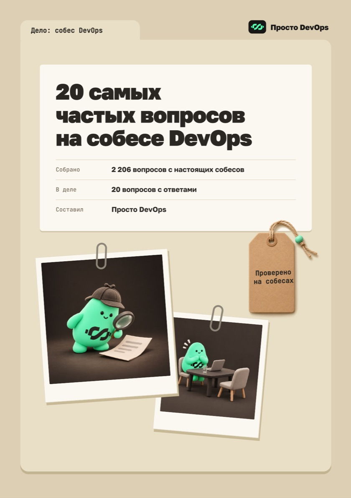
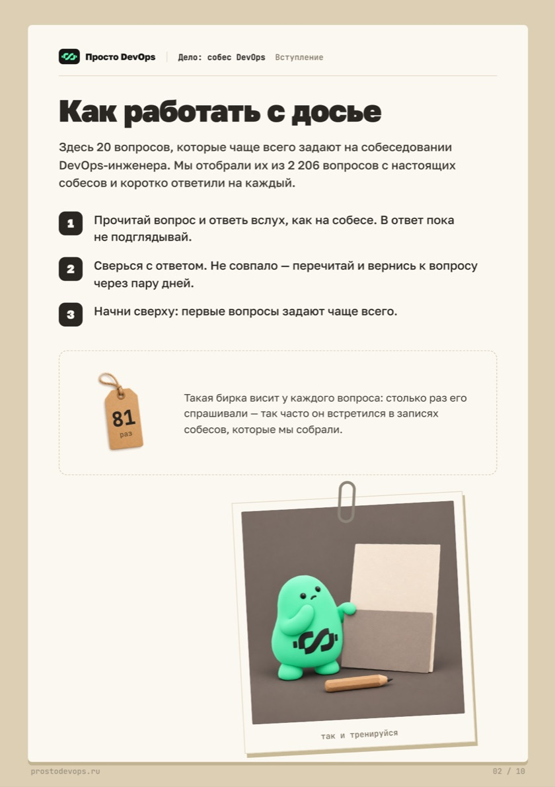
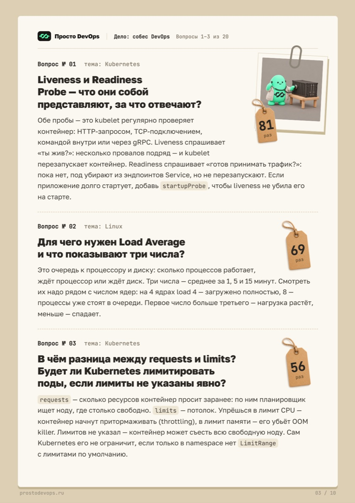
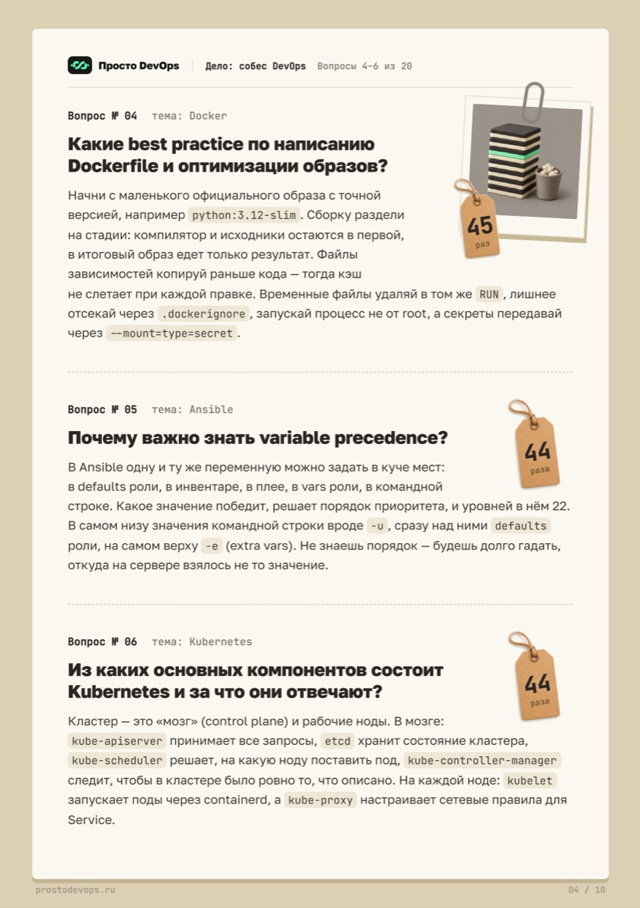
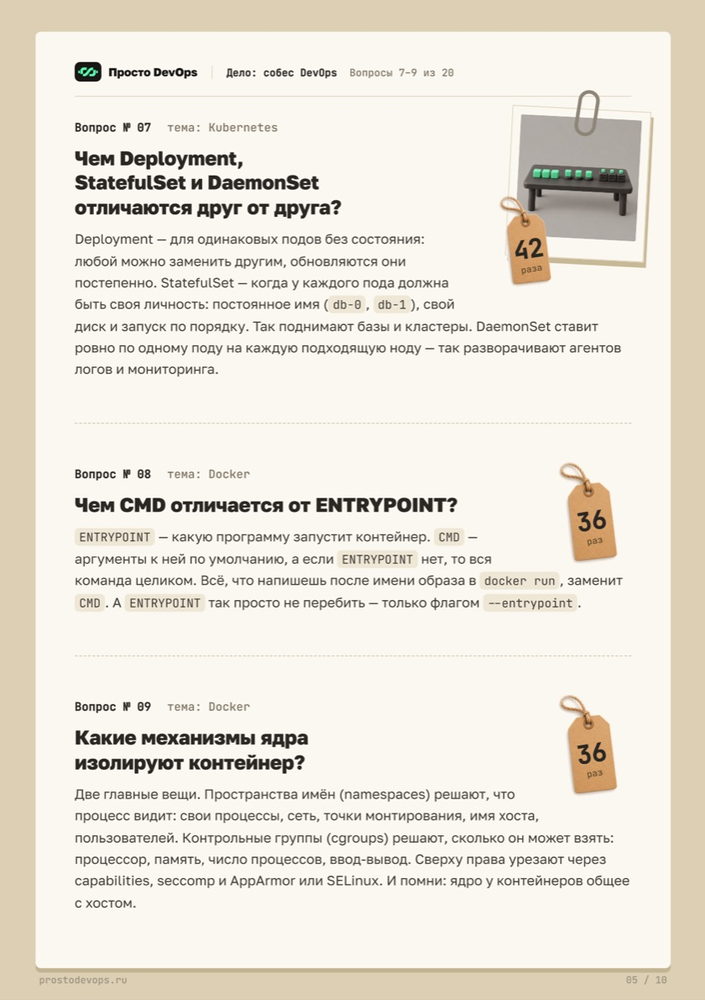
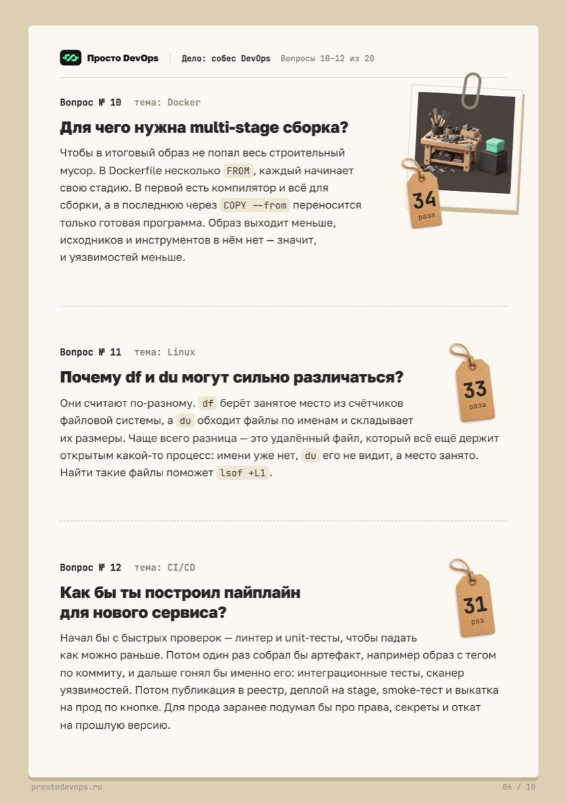
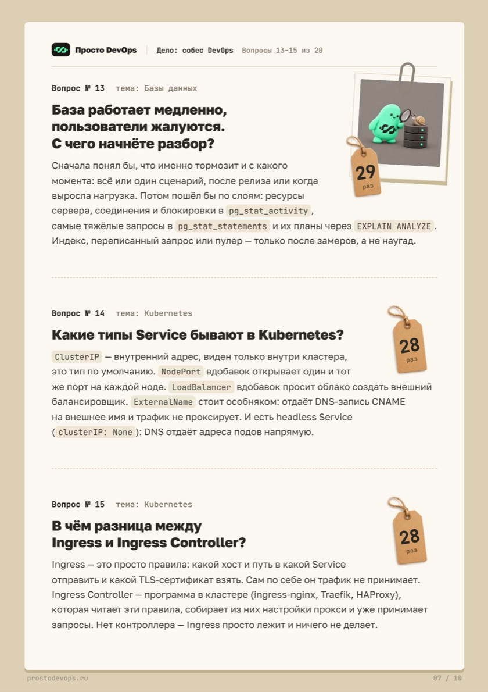
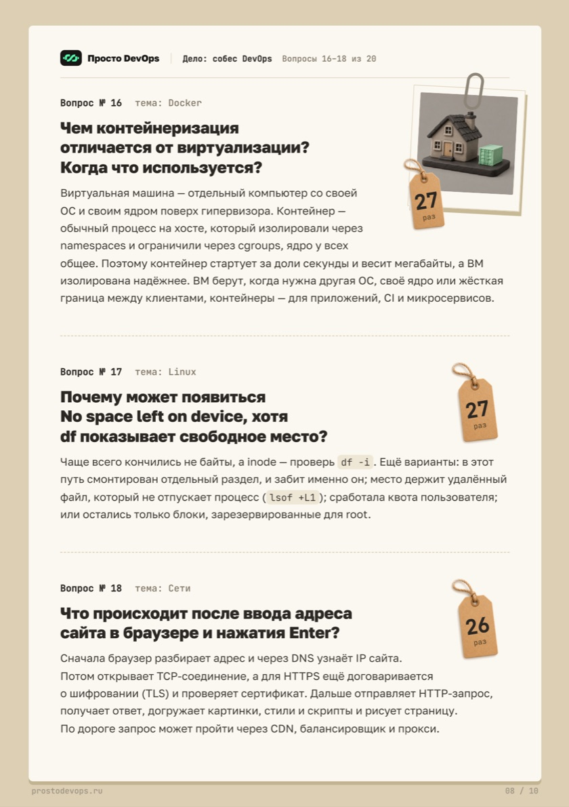
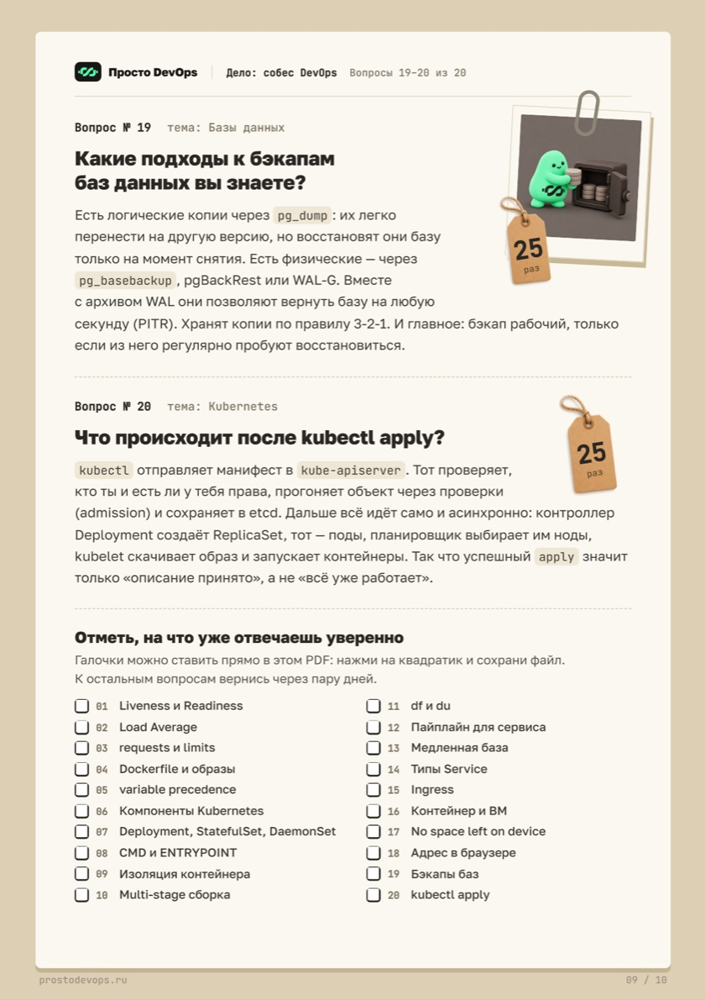

Досье от «Просто DevOps»: 20 вопросов, которые чаще всего встречались на настоящих собеседованиях
DevOps-инженеров, и короткий ответ на каждый. Вопросы идут по убыванию частоты, у каждого указано,
сколько раз его задавали. Темы — Kubernetes, Linux, Docker, Ansible, CI/CD, сети и базы данных.

Как тренироваться: прочитайте вопрос, ответьте вслух, как на собеседовании, и только потом сверьтесь
с ответом. Что не получилось — повторите через пару дней. На последней странице PDF есть чек-лист
с галочками: отмечайте вопросы, на которые уже отвечаете уверенно.

[Скачать досье в PDF](./assets/devops-interview-20/devops-interview-20-questions.pdf)

> Материал принадлежит «Просто DevOps» и опубликован с разрешения. На него не распространяется
> лицензия CC BY-SA 4.0, под которой выходят остальные материалы хаба: копировать и переделывать
> его без согласия правообладателя нельзя.

## Вопросы

1. Liveness и Readiness Probe
2. Load Average
3. requests и limits
4. Dockerfile и оптимизация образов
5. Variable precedence в Ansible
6. Компоненты Kubernetes
7. Deployment, StatefulSet, DaemonSet
8. CMD и ENTRYPOINT
9. Изоляция контейнера
10. Multi-stage сборка
11. Почему df и du показывают разное
12. Пайплайн для сервиса
13. База работает медленно — что делать
14. Типы Service
15. Ingress и Ingress Controller
16. Контейнеризация и виртуализация
17. No space left on device при свободном месте
18. Что происходит после ввода адреса сайта в браузере
19. Бэкапы баз данных
20. Что происходит после `kubectl apply`

## Досье

